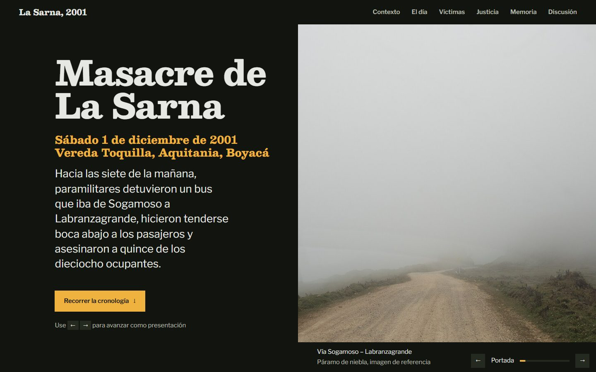
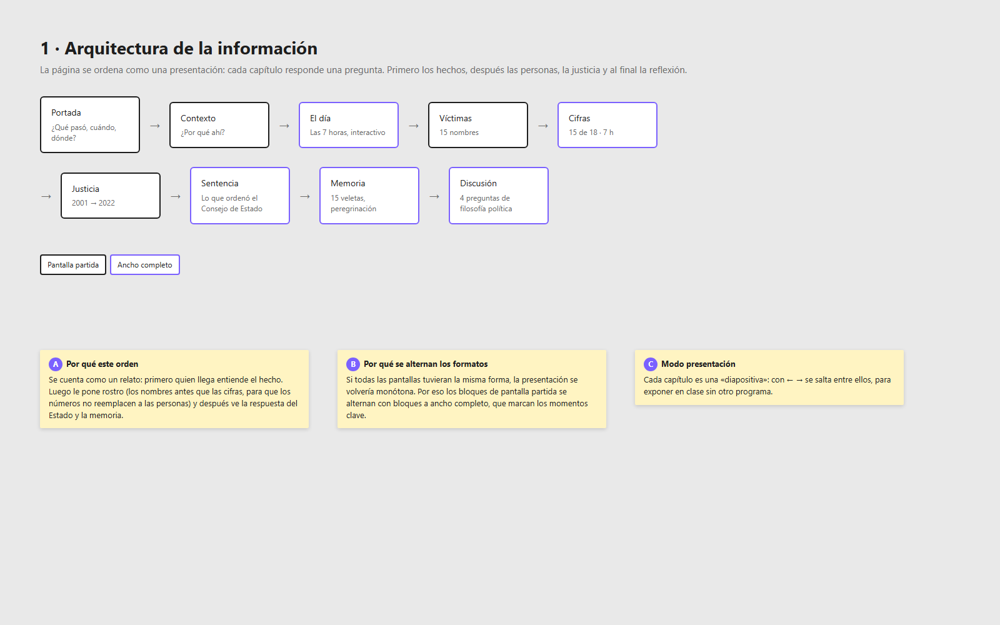
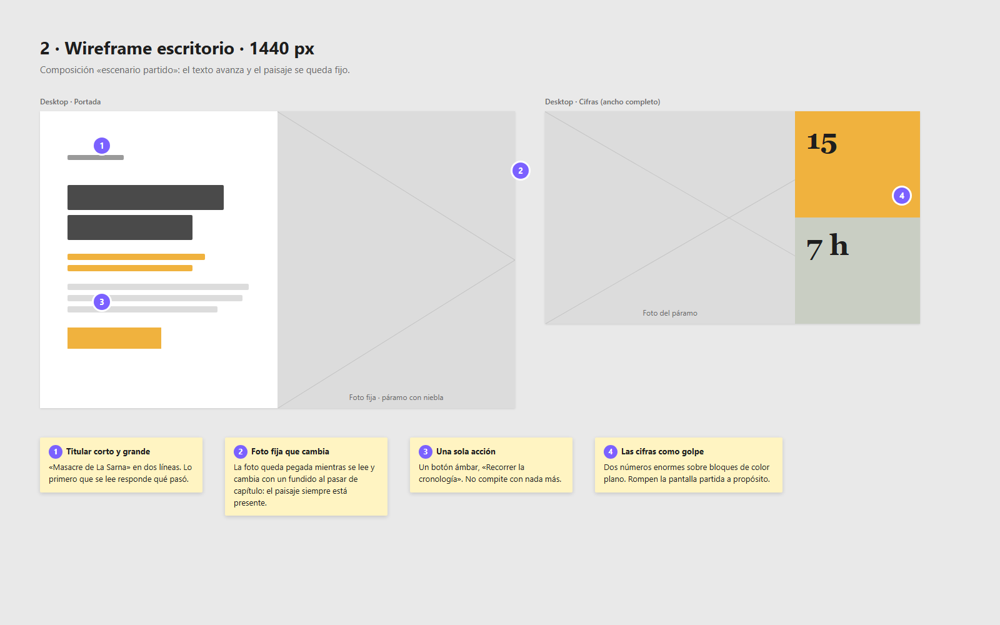
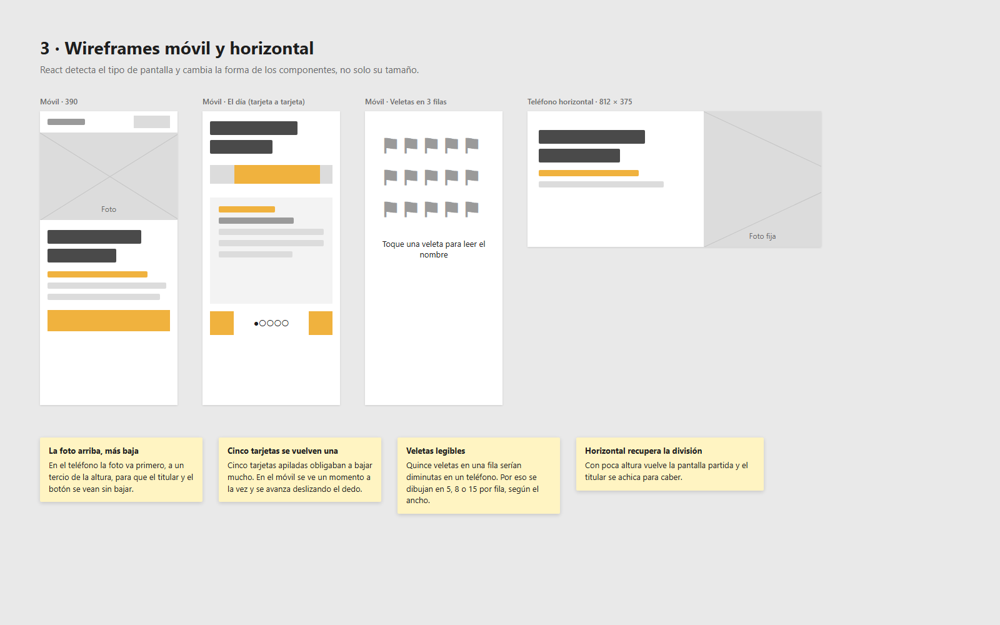
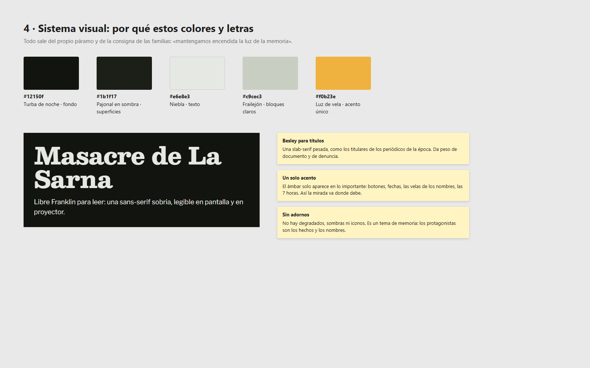
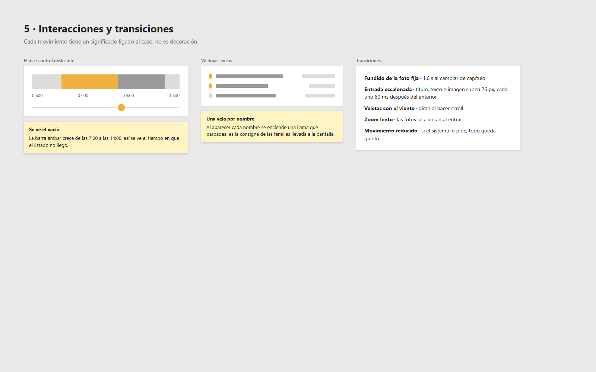

# Masacre del páramo de La Sarna, 2001

Una presentación web, en forma de línea de tiempo, sobre la masacre del páramo de La Sarna (Aquitania, Boyacá, Colombia), hecha para un trabajo de **filosofía política**.

**Ver la página:** https://lancelot0079.github.io/paramo-la-sarna/

## De qué trata

El sábado 1 de diciembre de 2001, hacia las 7:00 a. m., paramilitares de las Autodefensas Campesinas del Casanare detuvieron un bus que iba de Sogamoso a Labranzagrande, en el páramo de La Sarna. Asesinaron a 15 de los 18 ocupantes. Las autoridades llegaron siete horas después. En 2019 el Consejo de Estado ratificó la condena a la Nación: el Ejército y la Policía respondieron por omisión y por connivencia con los paramilitares.

La página recorre el caso en nueve capítulos:

1. **Portada**: qué pasó, cuándo y dónde.
2. **Contexto**: el corredor en disputa y el estigma contra la provincia de La Libertad.
3. **El día**: las siete horas sin Estado, con un control interactivo.
4. **Víctimas**: los 15 nombres, con edad y oficio.
5. **Cifras**: 15 de 18 ocupantes asesinados y 7 horas sin respuesta.
6. **Justicia**: los procesos judiciales de 2001 a 2022.
7. **La sentencia**: lo que ordenó el Consejo de Estado.
8. **Memoria**: las 15 veletas del lugar de memoria y la peregrinación anual.
9. **Discusión**: cuatro preguntas que relacionan el caso con Weber, Hobbes, Schmitt, Agamben y la justicia transicional.

## Propósito

- Servir de apoyo visual para exponer el caso en clase. Funciona como diapositivas: con las flechas **← →** se pasa de capítulo.
- Dar a las víctimas un lugar central: sus nombres aparecen antes que las cifras.
- Usar el caso para pensar problemas de filosofía política: la legitimidad del Estado, el deber de protección, el estigma y la reparación.

## Cómo verla

| Opción | Pasos |
| --- | --- |
| En línea | Abrir https://lancelot0079.github.io/paramo-la-sarna/ |
| Sin instalar nada | Descargar el repositorio y abrir `docs/index.html` con doble clic |
| Para editar | `npm install` y luego `npm run dev` |

Después de editar, `npm run build` regenera la carpeta `docs/`, que es la que publica GitHub Pages.

## Cómo está hecha

- **React 18 + Vite.** La compilación genera un solo `index.html` (con `vite-plugin-singlefile`), que se abre sin servidor.
- **Adaptable de verdad.** Además de cambiar de tamaño, los componentes cambian de forma según la pantalla (hook `useScreen`):
  - en el teléfono, «El día» se ve tarjeta por tarjeta y se avanza deslizando;
  - las veletas se dibujan en 5, 8 o 15 por fila, según el ancho;
  - en un teléfono en horizontal vuelve la pantalla partida;
  - en las pantallas grandes el ancho del contenido queda limitado.

| Archivo | Contenido |
| --- | --- |
| `src/data.jsx` | Textos, víctimas, fechas y fuentes |
| `src/components/Sections.jsx` | Los capítulos |
| `src/components/Chrome.jsx` | Navegación, indicador de capítulo y pie |
| `src/hooks.js` | Detección de pantalla y de capítulo activo |
| `src/styles.css` | Estilos y reglas por tamaño de pantalla |
| `public/assets/` | Imágenes |
| `version-html/` | Versión anterior en HTML puro |

## Mockups: cómo y por qué se diseñó así

La carpeta [`mockups/`](mockups/) tiene los esquemas de diseño, al estilo Figma ([`mockups.html`](mockups/mockups.html)), y sus capturas:

| | |
| --- | --- |
|  | **1. Arquitectura de la información.** Orden de los capítulos y por qué se alternan la pantalla partida y el ancho completo. |
|  | **2. Escritorio.** El «escenario partido»: el texto avanza y el paisaje queda fijo. |
|  | **3. Móvil y horizontal.** Cómo cambian los componentes en pantallas pequeñas. |
|  | **4. Sistema visual.** Colores tomados del páramo y la luz de vela de la consigna de las familias. |
|  | **5. Interacciones.** Qué significa cada movimiento. |

## Fuentes

- [Cinep, Revista Cien Días (2022)](https://www.revistaciendiascinep.com/home/marcas-de-la-memoria-21-anos-de-la-masacre-del-paramo-de-la-sarna/)
- [Rutas del Conflicto](https://rutasdelconflicto.com/masacres/el-paramo-la-sarna)
- [Consejo de Estado, boletín 223](https://www.consejodeestado.gov.co/documentos/boletines/223/15001-23-31-000-2003-03453-01.pdf)
- [Vanguardia (2019)](https://www.vanguardia.com/colombia/condenan-al-estado-por-masacre-en-boyaca-AG1459772)
- [Prensa Libre Casanare](https://prensalibrecasanare.com/judicial/34736-consejo-de-estado-ratificu-condena-contra-la-naciun-por-masacre-del-pbramo-de-la-sarna.html)

Algunas fuentes no coinciden en ciertos datos, por ejemplo el número de víctimas (11 o 15) o las edades de los sobrevivientes. La página lo señala.

## Imágenes

Son paisajes de páramo de Boyacá y Cundinamarca tomados de Wikimedia Commons, con licencias CC0, CC BY y CC BY-SA. Los créditos completos están al pie de la página. **No son fotos del lugar exacto de los hechos.**

El texto del sitio y los mockups son material educativo. Las imágenes conservan sus licencias originales.
